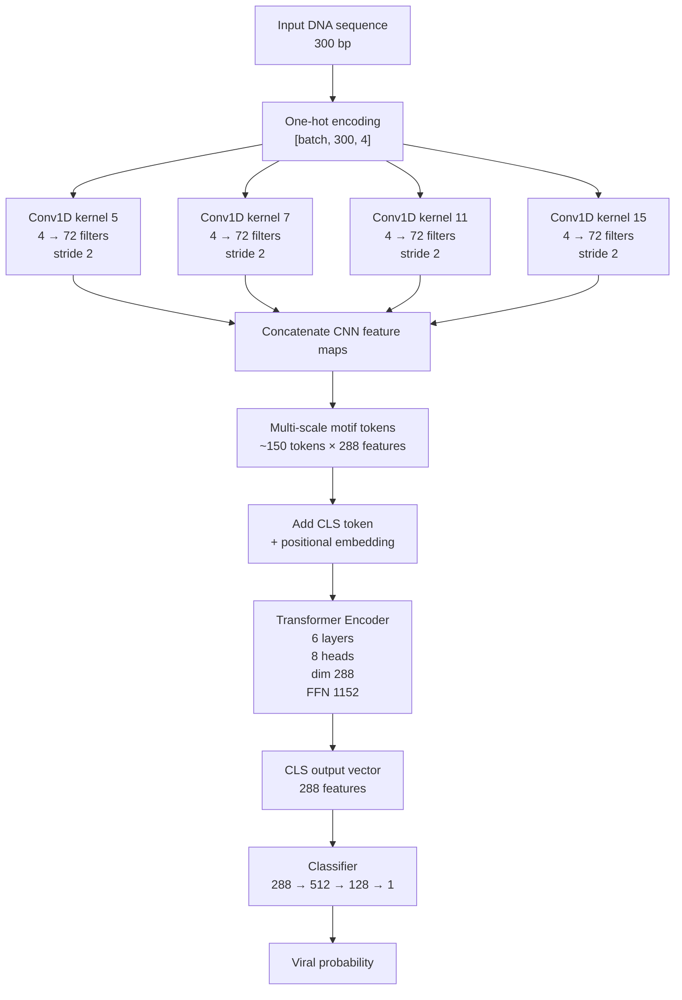

# ViraMiner3 CNN–Transformer comparison 

This is a large-model comparison of CNN–Transformer experiments. 
It keeps the same training protocol as the viraminer
comparison: reverse-complement/shift augmentation, focal loss, AdamW, warm-up +
cosine scheduling, Transformer freezing during warm-up, early stopping on
validation AUROC, and final test evaluation from the best validation checkpoint.

This focuses on a sharper question:

> Can we improve the baseline by changing the CNN motif encoder or the final
> token aggregation, rather than simply adding generic capacity?

The script is:

```text
compare_viraminer3_cnn_transformers_trial2.py
```

## Baseline architecture



## Variants tested

| Variant | What it tests | Parameters |
|---|---|---:|
| `current-cnn-transformer` | Baseline architecture from trial 1 | 6,265,377 |
| `two-kernels-7-11` | Simpler CNN motif encoder: only kernels 7 and 11, with 144 filters each | 6,265,377 |
| `four-kernels-128-dim512` | Larger CNN motif encoder: four kernels with 128 filters each, producing 512-dim Transformer tokens directly | 19,343,617 |
| `cls-plus-attention-pooling` | Combines CLS summary with learned attention pooling over motif tokens; classifier input is 576 | 6,413,698 |
| `local-attention-64` | Keeps CLS global but restricts motif-token self-attention to a local ±64-token window | 6,265,377 |

The `two-kernels-7-11` variant keeps the same total CNN output dimension as the
baseline:

```text
2 kernels × 144 filters = 288 features
```

The `four-kernels-128-dim512` variant makes the CNN stem itself produce a
512-dimensional token:

```text
4 kernels × 128 filters = 512 features
```

So unlike the previous `transformer-dim-512` test, this variant does not merely
project 288 CNN features into 512 Transformer dimensions. It increases the CNN
motif feature maps too.

The `cls-plus-attention-pooling` variant concatenates:

```text
CLS output:                288 features
learned pooled token output: 288 features
total classifier input:    576 features
```

The `local-attention-64` variant applies locality only among motif tokens. The
CLS token remains global: CLS can attend to every motif token, and every motif
token can attend back to CLS.

## How to run

On the large GPU machine:

```bash
python compare_viraminer3_cnn_transformers_trial2.py \
  --data-path /home/fusaro/viraminer/dataset \
  --save-dir /home/fusaro/viraminer/cnn_transformer_variants_trial2 \
  --epochs 120 \
  --batch-size 128 \
  --device cuda
```

By default, each variant can train up to 120 epochs and uses early stopping with
patience 15 based on validation AUROC.

To resume interrupted runs:

```bash
python compare_viraminer3_cnn_transformers_trial2.py \
  --data-path /home/fusaro/viraminer/dataset \
  --save-dir /home/fusaro/viraminer/cnn_transformer_variants_trial2 \
  --epochs 120 \
  --batch-size 128 \
  --device cuda \
  --resume
```

To run only selected variants:

```bash
python compare_viraminer3_cnn_transformers_trial2.py \
  --variants current-cnn-transformer,cls-plus-attention-pooling \
  --data-path /home/fusaro/viraminer/dataset \
  --save-dir /home/fusaro/viraminer/cnn_transformer_variants_trial2 \
  --device cuda
```

## Where to find results

The main output directory contains:

| File | Meaning |
|---|---|
| `summary.csv` | Main table with validation/test metrics for all variants |
| `summary.json` | Same summary in JSON format |
| `variant_comparison.png` | Bar/scatter plots comparing variants |
| `validation_learning_curves.png` | Validation AUROC curves across epochs |

Each variant also gets its own folder, for example:

```text
/home/fusaro/viraminer/cnn_transformer_variants_trial2/current-cnn-transformer/
```

Inside each variant folder:

| File | Meaning |
|---|---|
| `config.json` | Exact model configuration |
| `history.csv` | Per-epoch training loss and validation AUROC |
| `checkpoint.pt` | Latest training checkpoint for resume |
| `best_model.pt` | Best validation-AUROC model |
| `test_metrics.json` | Final test metrics |
| `test_predictions.csv` | Per-sequence test probabilities |
| `test_curves.png` | ROC and precision-recall curves |
| `classification_report.txt` | Sklearn classification report |
| `result.json` | Compact final result for the variant |

Use `summary.csv` first. Select models by validation AUROC, then interpret the
test metrics as the held-out estimate for the selected checkpoints.
